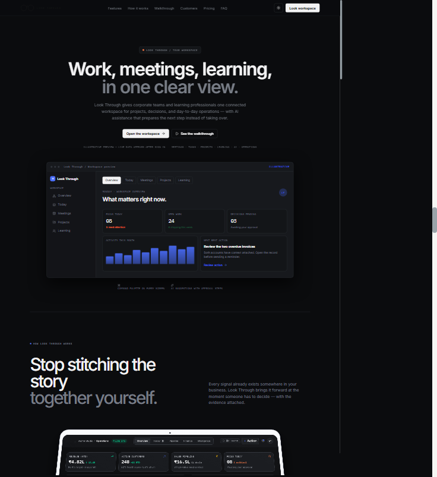
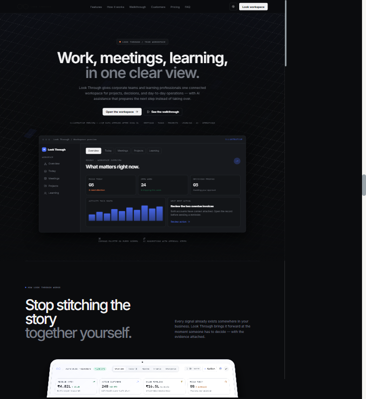
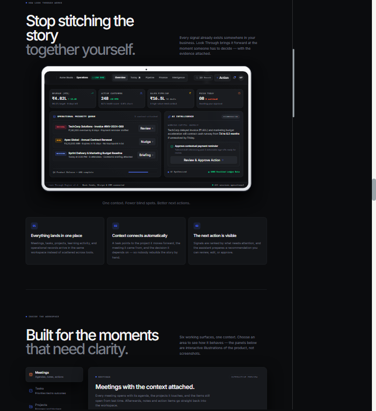
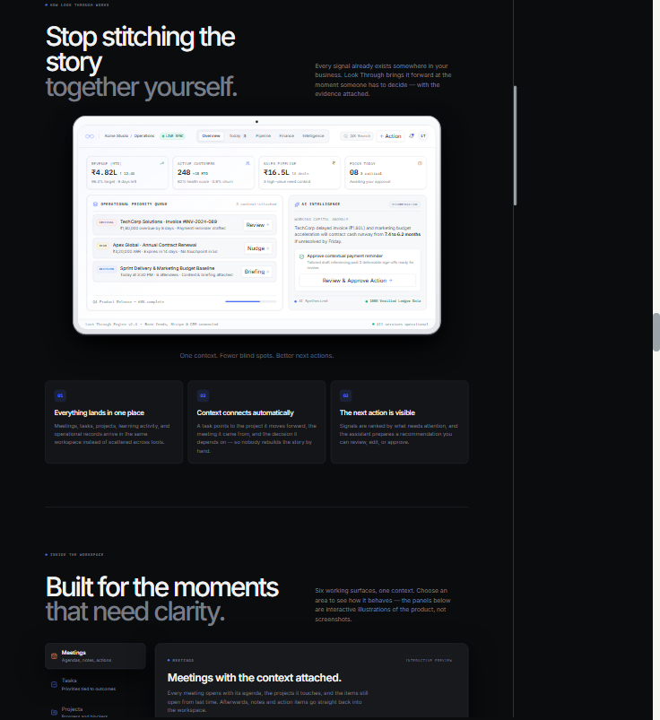
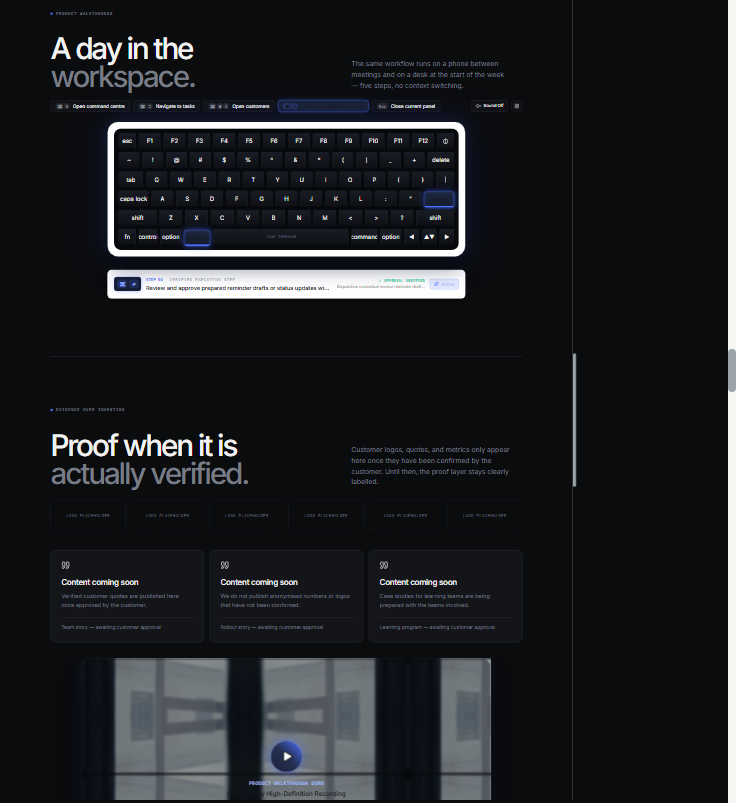
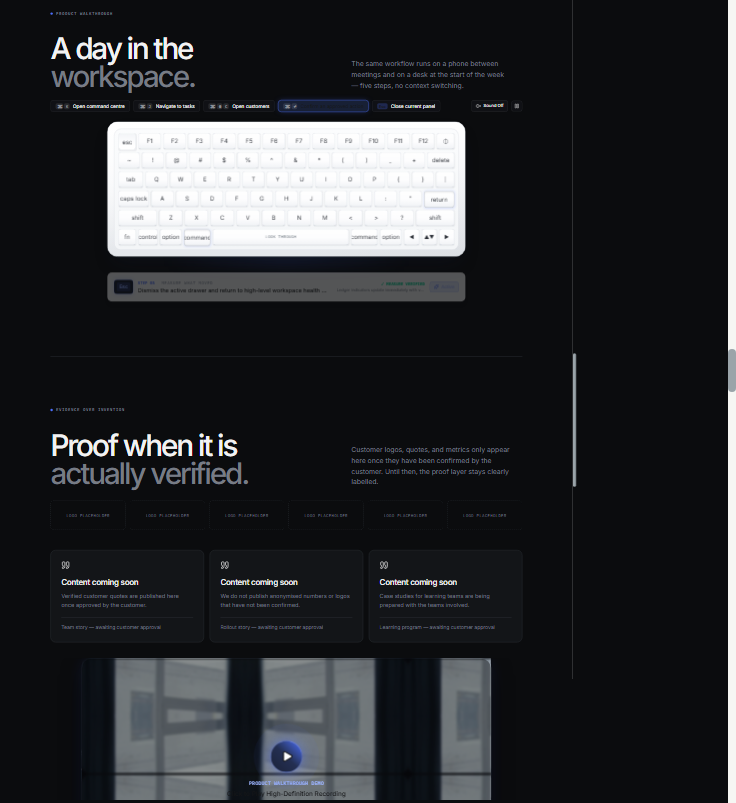

# Targeted Visual Refinement Report — Look Through

**Scope:** hero background treatment, illustrative tablet display, walkthrough keyboard.
**No** navigation, hero copy, CTA behaviour, dashboard, auth, API, database or business logic was changed.

---

## 1. Original visual issues

| Area | Issue |
| --- | --- |
| Hero background | A static CSS grid (`lp-hero-bg::before`) with masked 68px lines and three unused, `display:none` "beam" spans. No depth, no motion, and the intended accent layer was dead code. |
| Tablet display | Premium white/silver hardware surrounded a **dark charcoal** screen (`#0B0C0E`, `#15171B` panels). The hardware said "white product", the screen said "dark app", so the device read as a floating dark card rather than a real tablet. |
| Keyboard | Black keycaps with grey/blue legends, blue-glow pressed state, dark recessed switch plate. Looked like a gaming keyboard, not Apple hardware. |

## 2. Background boxes integration

**Status: FIXED AND VERIFIED**

- Added `src/components/ui/background-boxes.tsx` (`Boxes` / `BoxesCore`) implementing the Aceternity registry geometry: a large skewed/rotated plane (`skewX(-42deg) skewY(12deg) scale(.62)`) of 64px square cells with a slow 38s drift, twelve deterministically illuminated cells, and a pointer-following blue illumination layer.
- Replaced only the hero's background layer in `HeroSection.tsx`:

  ```tsx
  <div className="lp-hero-bg">
    <Boxes />
  </div>
  ```

  The old `::before` grid and the three `.lp-beam` spans plus their CSS were removed.
- Stacking: `.lp-hero-bg` is `position:absolute; inset:0; pointer-events:none; overflow:hidden`; the hero content keeps `position:relative; z-index:1`. Verified at runtime: `pointer-events: none` and `elementFromPoint` over the primary CTA resolves to the CTA button, so no click interception.
- Content, typography, spacing, nav, CTAs and the workspace preview markup were untouched.

**Theme behaviour:** the base uses the existing `--story-bg` token. On the charcoal identity the hero reads as near-black with restrained blue box highlights; on the light theme the same lattice renders as a faint warm-grey grid so the light theme's typography stays legible. Forcing a permanently charcoal hero would have required rewriting hero text colours and breaking the global theme architecture, which is explicitly out of scope.

## 3. Registry compatibility findings

| Check | Result |
| --- | --- |
| `components.json` (shadcn) | **Absent.** shadcn/ui is not configured; `npx shadcn add` would have scaffolded config and rewritten Tailwind entry points. Not run. |
| `@/` path alias | **Absent** (`tsconfig` has no `paths`, Vite has no alias). Registry imports (`@/components/ui/...`, `@/lib/utils`) are not resolvable. |
| Tailwind CSS | v4.3 via `@tailwindcss/vite`; no `tailwind.config.*`. Registry class names are v3-era but compatible. |
| TypeScript | 6.0, strict, `erasableSyntaxOnly`, React 19. |
| Motion | `motion@^14.6.0` already installed (`motion/react`), which is exactly what the registry component imports. **No new dependency.** |
| `cn` helper (`clsx` + `tailwind-merge`) | Packages exist, but no `lib/utils` file; the implementation avoids `cn` entirely. |
| Registry implementation viability | The upstream `Boxes` renders **150 × 100 = 15,000** `motion.div` nodes and picks a random colour from a 9-colour rainbow palette on every hover. That is unacceptable for a production hero (and violates the brief's "no excessive animated box rendering"). |

**Adaptation (smallest compatible implementation):** identical skew/rotation geometry and square-cell language, but the lattice is drawn with two CSS gradients on one element, and only 12 cells animate opacity (6 on mobile). The pointer updates two CSS custom properties through a rAF-coalesced listener instead of per-cell React state. This keeps the Aceternity look at a fraction of the DOM and paint cost.

## 4. Dependencies added

**None.** No packages were installed, added to `package.json`, or to the lockfile.

## 5. Tablet hardware preservation

**Status: PASS**

- `ContainerScroll` scroll-driven rotation (`16° → 0°`), scale (`0.94 → 1`), translate, perspective (`1100px` / `800px` mobile), easing and viewport offsets are **byte-for-byte unchanged**.
- White/silver frame gradient, corner radii, bezel camera sensor, metallic edge rings and soft shadow are preserved.
- Only the screen gasket colour changed from near-black `#0B0C0E` / `#20232A` to a light `#FFFFFF` / `#C9CFD8` with a 1px inner white bevel, because a dark gasket around a white display looked like a pasted card.
- No image replacement, no second animation library, reduced-motion branch untouched.

## 6. Tablet light-screen implementation

**Status: FIXED AND VERIFIED**

`StoryTabletMockup.tsx` was re-skinned, not rebuilt: every content block, figure and module (Overview, KPI metrics, Operational Priority Queue, AI Intelligence, nav, LIVE SYNC indicator, status footer) is retained verbatim.

- New component-scoped palette `.lt-tablet` (independent of site tokens, `color-scheme: light`):

  | Token | Value |
  | --- | --- |
  | Screen | `#FFFFFF` |
  | Secondary surface | `#F7F8FA` |
  | Primary text | `#202124` |
  | Secondary text | `#626A73` |
  | Muted text | `#8A919A` |
  | Borders | `#E5E7EB` |
  | Accent | existing Look Through blue `#4c6fff` |

- Widgets are white cards with 1px neutral borders and a 1px ambient shadow; the AI panel is grey/white with dark readable type and a white action surface. The previous blue ambient blur was removed so AI reads as neutral intelligence, not neon.
- Status semantics stay colour-coded but muted (critical red, high amber, decision blue, verified green).
- The dashboard theme provider and every application token are untouched; only this illustrative mockup is light.

## 7. Keyboard hardware transformation

**Status: FIXED AND VERIFIED**

Keyboard structure, layout array, auto-play cycle, shortcuts, physical-key listener, reduced-motion handling and the Web Audio click engine are **unchanged**. Only visual classes were replaced with component-scoped `.lt-keyboard*` styles:

- Chassis: white → silver aluminium vertical gradient, 1px `#cfd4db` edge, inset top highlight, inset bottom shade, soft 24px ambient shadow with a barely-there blue tint.
- Chamfer sheen layer over the body.
- Switch plate: `#fbfcfd → #f3f5f7` with a fine border and inset shadow.
- Keycaps: `#ffffff → #f1f3f6` gradient, `#e2e5ea` sides, 2px `#c9ced6` bottom edge, dark legends.
- Pressed: `translateY(2px)`, flatter highlight, inset shadow and a 0.18-alpha blue outer glow; **the cap stays white** — the inner blue strip was removed.
- No black keycaps, no white-on-black legends, no RGB, no rainbow, no glow wash.

Definitions live in `landing.css`, deliberately **without** global theme tokens or `bg-white`/`text-white`/`bg-gradient-*` utilities, because `index.css` remaps those globally with `!important` (`--surface`, `--ink`) — using them would invert the keyboard with the site theme.

## 8. White keycap and black legend verification

**Status: FIXED AND VERIFIED** (computed styles read from the live DOM in both themes)

| Theme | First keycap background | Legend colour | Chassis | Switch plate |
| --- | --- | --- | --- | --- |
| Dark site theme | `linear-gradient(#fff → #fdfdfe → #f1f3f6)` | `rgb(43, 47, 54)` | `#ffffff → #f4f5f7 → #e3e6ea` | `#fbfcfd → #f3f5f7` |
| Light site theme | `linear-gradient(#fff → #fdfdfe → #f1f3f6)` | `rgb(43, 47, 54)` | `#ffffff → #f4f5f7 → #e3e6ea` | `#fbfcfd → #f3f5f7` |

Identical in both themes — the hardware is not bound to global tokens. All 77 keycaps are white; letters, numbers, punctuation and function symbols render in `#2b2f36` (dark grey) with `#6b7280` sublegends. Spacebar reads `LOOK THROUGH` in dark grey.

## 9. Keyboard interaction and sound verification

**Status: PASS (interaction) / NOT VERIFIED (audible playback)**

- Interaction code untouched: shortcut chips, auto-play (3.8s), pressed-key set, physical `keydown`/`keyup` mapping, play/pause, sound on/off and `sessionStorage` persistence behave exactly as before.
- Pressed geometry verified in-browser: computed transform `matrix(1, 0, 0, 1, 0, 2)` (2px depression) with the existing shadow transition.
- Sound remains opt-in (`Sound Off` by default), synthesized by the existing Web Audio engine — no library added, no autoplay.
- The sandbox has no audio device, so audible output could not be confirmed; this is unchanged behaviour with no code edits in that path.

## 10. Responsive testing results

Measured with same-origin iframes at exact viewport widths (scrollbar excluded):

| Viewport | Horizontal overflow | Hero h1 width | Tablet width | Keyboard body | Key rows fit | Boxes cells | Grid cell |
| --- | --- | --- | --- | --- | --- | --- | --- |
| 1440 × 900 | None (1432) | 902 | 1010 | 896 | Yes | 12 | 64px |
| 1280 × 800 | None (1272) | 902 | 1010 | 896 | Yes | 12 | 64px |
| 1024 × 768 | None (1016) | 730 | 957 | 896 | Yes | 12 | 64px |
| 768 × 1024 | None (760) | 547 | 591 | 620 | Yes | 12 | 64px |
| 390 × 844 | None (382) | 342 | 329 | 350 | Yes | 6 visible | 46px |
| 375 × 812 | None (367) | 327 | 314 | 335 | Yes | 6 visible | 46px |

Also verified: `.lp-hero-bg` never receives pointer events; CTA hit-testing succeeds at 375/1440; 77 keycaps render at all widths; no clipped key legends after the narrow-width legend sizing pass; tablet remains white/light and readable throughout.

Reduced motion is implemented in both layers (`useReducedMotion` skips the cell keyframes and the pointer listener; CSS disables drift, and a static 0.12-opacity cell state remains). It could not be runtime-emulated in this sandbox, so it is code/CSS-verified only.

## 11. Performance observations

- Background boxes: **1** grid element, **1** aura, **1** vignette, 12 animated nodes (6 on mobile) — versus the registry's 15,000. Pointer work is a single rAF-coalesced write of two CSS variables; listener removed on unmount with `cancelAnimationFrame` cleanup.
- Only `opacity` and `transform` animate; no filters or blur on the box layer beyond the existing hero vignette gradient.
- No new JS bundle dependency; added CSS is a few KB and tree-shaken into the landing stylesheet.
- Keyboard/tablet add no animation frames: existing Motion/scroll animations only, new styles are static CSS.
- Build output unchanged in character: `index-*.js` 555 kB (163 kB gzip), CSS 190.7 kB (33.4 kB gzip) — existing large-chunk warning persists, unrelated to this work.

## 12. Files modified

| File | Change |
| --- | --- |
| `src/components/ui/background-boxes.tsx` | **New** — adapted Aceternity `Boxes` (motion, no deps). |
| `src/components/landing/HeroSection.tsx` | Swaps the static grid/beam layer for `<Boxes />`; all content untouched. |
| `src/components/landing/landing.css` | Removes hero grid/beam rules; adds `.lt-boxes*`, `.lt-tablet` / `.lt-t-*` light display theme, `.lt-keyboard*` white hardware. |
| `src/components/landing/StoryTabletMockup.tsx` | Light-theme re-skin of the existing screen, same content/structure. |
| `src/components/ui/container-scroll-animation.tsx` | Screen gasket colour only; animation untouched. |
| `src/components/ui/keyboard.tsx` | Visual classes only; all logic preserved, inner blue key strip removed. |
| `docs/TARGETED_VISUAL_REFINEMENT_REPORT.md` | This report. |
| `artifacts/*.png` | Verification screenshots (not tracked). |

## 13. Automated validation results

| Command | Result | Notes |
| --- | --- | --- |
| `npm run typecheck` | **PASS** (exit 0) | `tsc -b` clean. |
| `npm run build` | **PASS** (exit 0) | Built in 1.56s; only the pre-existing >500 kB chunk advisory. |
| `npm test` | **PASS** | 26/26 tests pass, 0 failed. |
| `git diff --check` | **PASS** (exit 0) | No whitespace errors. |
| `npm run lint` | **FAIL** (exit 1) | 1 error + 66 warnings, all **pre-existing** and outside the touched files. The error is `react-hooks(rules-of-hooks)` at `src/components/customers/CustomerDetailDrawer.tsx:44` (conditional `useEffect`). No findings in `landing/`, `ui/keyboard.tsx` or `ui/background-boxes.tsx`. |
| Browser console | **PARTIAL** | No runtime/module errors; Vite loaded every changed module with 200. Two unidentified 404 resource errors appear in the console without matching entries in the Vite server log or resource timing (not reproducible to a project asset). |
| Visual review | **PASS** | Dark/light hero at 1440 and 375, tablet at 1440, keyboard at 1440 + 736 in both themes. |

### Screenshots

| Before | After |
| --- | --- |
|  |  |
|  |  |
|  |  |

Additional evidence: `hero-1440-light-final.png`, `hero-375-light.png`, `keyboard-736-dark-final.png`, `keyboard-736-light-final.png`, `tablet-top.png`, `tablet-scroll.png`.

## 14. Remaining issues

1. **Lint baseline is red** — pre-existing conditional `useEffect` in `CustomerDetailDrawer.tsx:44`. Out of scope; left untouched.
2. **Reduced-motion runtime not emulated** — implemented via `useReducedMotion` + `@media (prefers-reduced-motion: reduce)`, verified by inspection only.
3. **Sound not audibly verified** — no audio device in the sandbox; engine and opt-in behaviour unchanged.
4. **Light-theme hero is not charcoal** — deliberate: the background follows `--story-bg` so both themes stay coherent and hero typography keeps its original tokens. The charcoal/near-black treatment applies to the product's primary dark identity.
5. **Two unidentified console 404s** on the dev preview, unrelated to changed assets; not present in server logs.
6. Nothing was committed, pushed or deployed.
